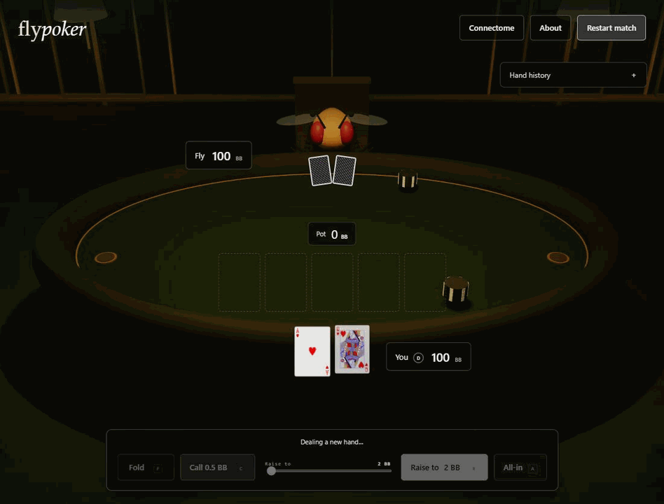

<h1 align="center">You vs a fruit fly</h1>

Play heads-up poker against a model built from a fruit fly's brain wiring. 134,209 neurons, 2.7 million connections, running in your browser.

[Play poker with the fly](https://pokerwithafly.vercel.app/)



## How it works

1. **Cards.** The model receives its own cards, the revealed community cards, stacks, and betting history. It cannot see your cards or the future deck.
2. **Brain.** The FlyWire connectome determines the connections and their signs. A trained rate-based network runs eight recurrent steps per decision.
3. **Action.** A learned readout turns motor and descending neuron activity into probabilities for legal poker actions. The game samples an action from those probabilities.
4. **Connectome.** Click the button in the top right to watch the model's neuron activity during each decision. Brightness is scaled within each neuron group so weaker activity stays visible.

Both players start with 100 big blinds. Blinds are 0.5 and 1 BB. Stacks carry between hands, and the dealer alternates.

## Training

The installed model completed 1,024 imitation updates on a Modal NVIDIA L4, using examples from a poker heuristic. It has no PPO updates. Training adjusts connection magnitudes, neuron parameters, and the input and output layers while preserving the graph's connections and signs.

Its playing strength remains unproven. Training on a biological graph does not establish an advantage over other poker models. See the [poker strength audit](docs/poker-strength-audit.md) for measured results and limitations.

## Run it

Requires Node.js 20 or later.

```sh
cd web
npm install
npm run brain:fetch
npm run dev
```

Run the web checks with `npm test` and `npm run build` from `web/`.

For the Python backend, datasets, Modal jobs, and evaluation commands, see the [training guide](docs/training-guide.md).

## Credits

Casino design and fly artwork inspired by [Carlo Esposito's fly-chess](https://github.com/cesp99/fly-chess). The artwork is MIT licensed, with its license retained alongside the assets.

Playing-card SVGs by [Adrian Kennard](https://www.me.uk/cards/), CC0.

The FlyWire graph and derived model artifacts are CC BY-NC 4.0, requiring attribution and non-commercial use. See [data provenance](docs/training-research.md) for the source and license details.
